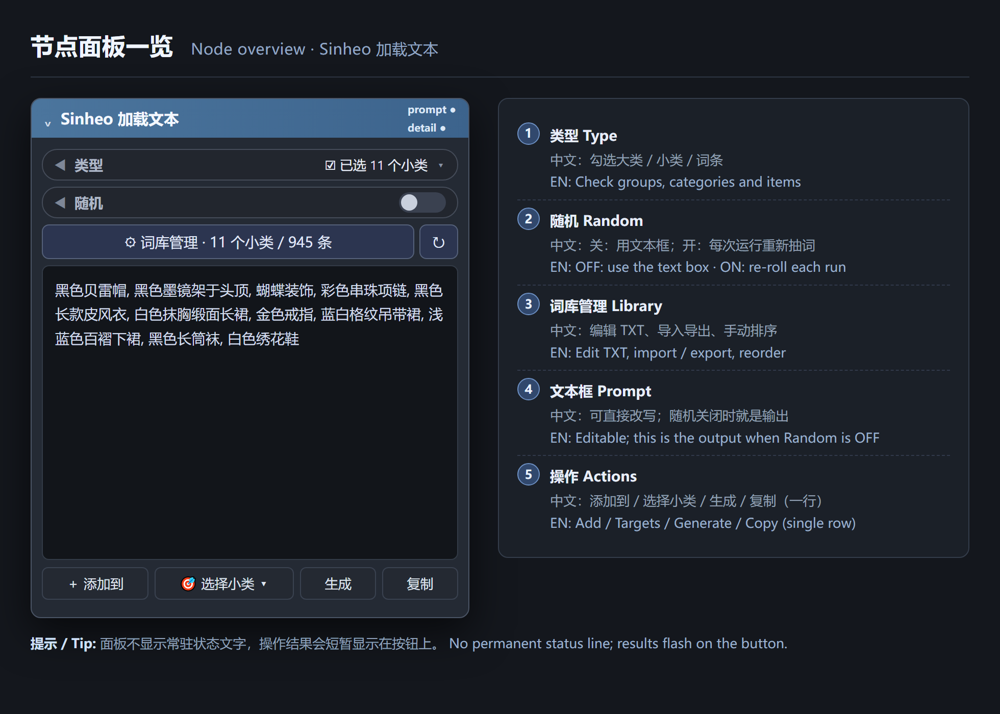
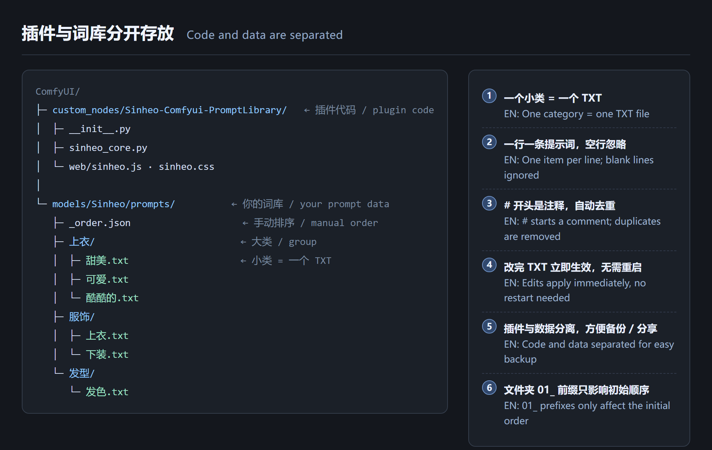
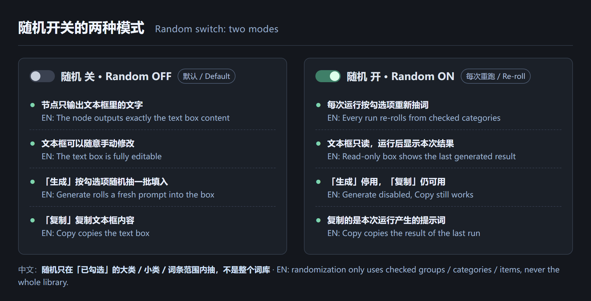
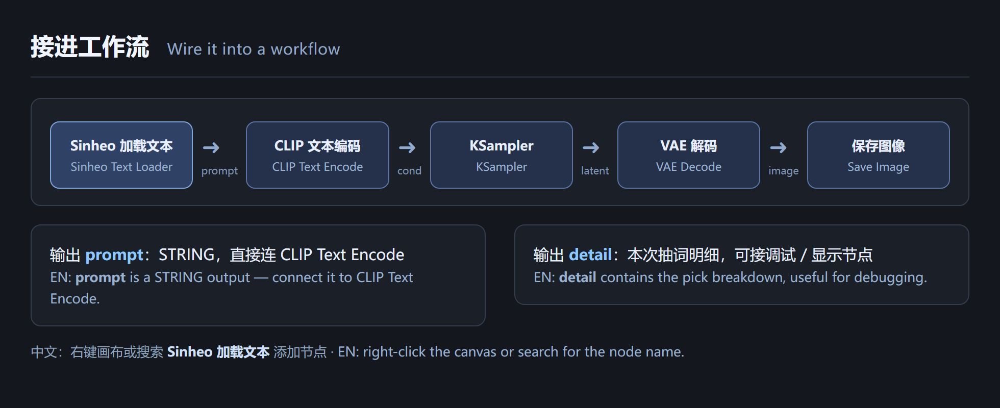
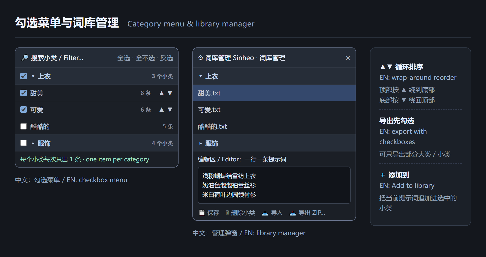

# Sinheo-Comfyui-PromptLibrary · Sinheo 加载文本 / Text Loader

> **仓库 & 插件目录 / Repo & plugin folder**：`Sinheo-Comfyui-PromptLibrary`（两者同名 / same name for both）
>
> **中文**：把「提示词管理.html」搬进 ComfyUI 的**文字版提示词库节点**，界面按 Goohai 图库节点的紧凑样式重做。勾选大类 / 小类、随机抽词、手动排序、词库管理、导入导出，全部在一个节点里完成。
> **English**: A **text-based prompt library node** for ComfyUI, styled after Goohai's compact image-library node. Pick groups / categories, roll random prompts, reorder them, manage the library, import & export — all from one node.



| 中文 | English |
| --- | --- |
| 本页是**中英对照**速览。 | This page is a **bilingual** quick reference. |
| **完整图文教程**（分 9 步、5 张插图）：[docs/TUTORIAL.md](docs/TUTORIAL.md) | **Full illustrated tutorial** (9 steps, 5 images): [docs/TUTORIAL.md](docs/TUTORIAL.md) |
| 中文完整参考手册：[docs/REFERENCE.zh-CN.md](docs/REFERENCE.zh-CN.md) | Full Chinese reference: [docs/REFERENCE.zh-CN.md](docs/REFERENCE.zh-CN.md) |
| 起步词库：[examples/prompts/](examples/prompts/) | Starter library: [examples/prompts/](examples/prompts/) |

---

## 1. 简介 | About

| 中文 | English |
| --- | --- |
| **插件和数据彻底分开**：代码在 `custom_nodes/`，提示词全在 `models/`。直接用资源管理器改 TXT 就能加词，不用重启 ComfyUI，备份 / 分享词库也不会碰到代码。 | **Code and data are separated**: the plugin lives in `custom_nodes/`, all prompts live in `models/`. Edit the TXT files in Explorer / Finder to add prompts — no restart, and backing up your library never touches the code. |
| 词库只有**两级**：`大类/` 文件夹 + `小类.txt` 文件。一个小类就是一个 TXT，每次随机只从该小类里出 **1 条**。 | The library has **two levels**: a `Group/` folder plus `Category.txt` files. One category = one TXT, and each roll contributes **exactly one item** per category. |
| 节点输出 `prompt`（STRING）与 `detail`（抽词明细），直接接 `CLIP Text Encode`。 | The node outputs `prompt` (STRING) and `detail` (pick breakdown); wire `prompt` straight into `CLIP Text Encode`. |

---

## 2. 安装 | Install

| 中文 | English |
| --- | --- |
| 把本仓库整个文件夹放进 `ComfyUI/custom_nodes/Sinheo-Comfyui-PromptLibrary/`，重启 ComfyUI，然后右键画布或搜索 **`Sinheo 加载文本`** 添加节点。 | Put this folder at `ComfyUI/custom_nodes/Sinheo-Comfyui-PromptLibrary/`, restart ComfyUI, then right-click the canvas or search for **`Sinheo 加载文本`** to add the node. |
| 仓库与插件目录**同名**，直接 `git clone <仓库地址> custom_nodes/Sinheo-Comfyui-PromptLibrary` 即可，解压 ZIP 也无需改名。 | The repo and the plugin folder share the **same name** — just run `git clone <repo-url> custom_nodes/Sinheo-Comfyui-PromptLibrary`; unzipping a ZIP needs no renaming either. |
| 想立刻有词可用：把 [examples/prompts/](examples/prompts/) 里的内容复制到 `ComfyUI/models/Sinheo/prompts/`。 | For an instant library, copy everything in [examples/prompts/](examples/prompts/) into `ComfyUI/models/Sinheo/prompts/`. |

```text
ComfyUI/
├── custom_nodes/
│   └── Sinheo-Comfyui-PromptLibrary/         ← 插件代码 / plugin code
│       ├── __init__.py          节点定义 + HTTP API / node + API
│       ├── sinheo_core.py       扫描、生成、编辑、导入导出 / core logic
│       └── web/sinheo.js|css    节点面板 / front-end panel
└── models/
    └── Sinheo/
        └── prompts/            ← 你的词库 / your prompt data
```



---

## 3. 词库规则 | Library rules

| 中文 | English |
| --- | --- |
| 一个小类 = 一个 TXT；一行一条提示词；空行忽略，`#` 开头是注释；同文件自动去重。 | One category = one TXT; one item per line; blank lines ignored; `#` starts a comment; duplicates are removed. |
| 文件夹名前的 `01_` `02_` 只影响**初始顺序**，界面会去掉前缀显示。真正的顺序靠菜单里的 ▲▼ 手动排，可「设为默认顺序」写进 `_order.json`。 | `01_` / `02_` prefixes only affect the **initial order** and are hidden in the UI. Real ordering is done with ▲▼ in the menu and can be saved to `_order.json`. |
| **循环排序**：顶部按 ▲ 绕到底部，底部按 ▼ 绕回顶部。 | **Wrap-around reorder**: ▲ on the first item sends it to the bottom; ▼ on the last sends it to the top. |
| 随机**只在已勾选**的大类 / 小类 / 词条范围内抽，不是整个词库。 | Randomization only uses **checked** groups / categories / items — never the whole library. |
| 改完 TXT 立即生效；也支持在 `extra_model_paths.yaml` 里追加 `sinheo_prompts` 只读目录。 | Edits apply immediately; extra read-only roots can be added via `sinheo_prompts` in `extra_model_paths.yaml`. |

---

## 4. 面板与按钮 | Panel & buttons


| 区域 | 中文 | English |
| --- | --- | --- |
| `◀ 类型 ▾` | 打开**勾选菜单**（代替下拉框），可勾选大类 / 小类 / 具体词条，可搜索、可排序。 | Opens the **checkbox menu**: check groups / categories / individual items, search and reorder. |
| `◀ 随机` | 总开关：关 = 输出文本框内容；开 = 每次运行按勾选项重新抽词。 | Master switch: OFF = output the text box; ON = re-roll on every run from checked items. |
| `⚙ 词库管理 · N / M` | 打开管理弹窗，编辑 TXT、新建 / 删除、导入导出；`↻` 重新扫描。 | Opens the manager: edit TXT, create / delete, import / export; `↻` rescans. |
| 大文本框 | 可直接编辑的提示词。随机关闭时它就是最终输出。 | Editable prompt text; this is the final output when Random is OFF. |
| `＋ 添加到` | 把当前提示词按行**追加**到选中的小类（只追加、保留注释、自动去重）。 | **Appends** the current prompt to chosen categories (append-only, keeps comments, skips duplicates). |
| `🎯 选择小类 ▾` | 弹窗勾选要添加到哪些小类，可记住多个目标。 | Checkbox dialog to pick target categories; targets are remembered. |
| `生成` | 手动随机抽一批填进文本框（仅随机关闭时可用）。 | Manually rolls a fresh prompt into the box (only when Random is OFF). |
| `复制` | 复制文本框内容；随机模式下复制**本次运行产生的**提示词。 | Copies the text box; with Random ON it copies **the result of the last run**. |

> 底部四个按钮固定**一行**，面板不显示常驻状态文字，操作结果会短暂显示在按钮上。
> The four buttons stay on a **single row**; there is no permanent status line — results flash on the button.

---

## 5. 两种模式 | Two modes



| 中文 | English |
| --- | --- |
| **随机 关（默认）**：节点只输出文本框里的文字，可随意手改；「生成」按勾选项抽一批填入；「复制」复制文本框。 | **Random OFF (default)**: outputs exactly the text box; edit freely; `Generate` rolls a fresh prompt; `Copy` copies the box. |
| **随机 开**：每次运行重新抽词，文本框只读并在运行后显示本次结果；「生成」停用，但「复制」与「＋ 添加到」仍可用。 | **Random ON**: re-rolls every run; the box is read-only and shows the last result; `Generate` is disabled while `Copy` and `Add to` still work. |
| 缓存指纹在随机开时返回 `NaN`，保证每次排队运行都会重新抽词。 | With Random ON the fingerprint returns `NaN`, so every queued run really re-rolls. |

---

## 6. 接入工作流 | Wire it into a workflow



| 中文 | English |
| --- | --- |
| `prompt` → `CLIP Text Encode` → `KSampler` → `VAE Decode` → `Save Image`。 | `prompt` → `CLIP Text Encode` → `KSampler` → `VAE Decode` → `Save Image`. |
| `detail` 是本次抽词明细，适合接调试 / 显示节点。 | `detail` holds the pick breakdown — handy for debugging. |

---

## 7. 词库管理、导入导出 | Manager, import & export



| 中文 | English |
| --- | --- |
| 导入可选「导入到大类」，支持 TXT / ZIP 拖入或直接选文件。 | Import lets you choose a target group from a dropdown; TXT / ZIP supported. |
| 点「导出 ZIP」会先弹出**勾选界面**，只导出勾中的大类 / 小类。 | `Export ZIP` opens a **checkbox dialog** first, so only checked groups / categories are exported. |
| 删除会把原文件备份到 `.backup/`；旧三级目录（大类/小类/多个 TXT）首次扫描时自动展平并整份备份。 | Deletions are backed up to `.backup/`; legacy three-level folders are auto-flattened and fully backed up on first scan. |
| 管理弹窗里可设置分隔符 / 前缀 / 后缀 / 一次生成条数。 | The manager also configures separator, prefix, suffix and batch size. |

---

## 8. HTTP API & 测试 | HTTP API & tests

| 中文 | English |
| --- | --- |
| 插件注册 11 个路由：`/sinheo/library`、`generate`、`save`、`create`、`delete`、`order`、`migrate`、`import`、`export`、`append` 等，全部由前端面板调用。 | The plugin registers 11 routes (`/sinheo/library`, `generate`, `save`, `create`, `delete`, `order`, `migrate`, `import`, `export`, `append`, …) used by the panel. |
| 见 [docs/REFERENCE.zh-CN.md](docs/REFERENCE.zh-CN.md) 的完整 API 表。 | See [docs/REFERENCE.zh-CN.md](docs/REFERENCE.zh-CN.md) for the full API table. |

```bash
python -m unittest discover -s tests -p "test_core.py" -v   # 17 core tests / 17 项核心单测
node tests/smoke_frontend.mjs                                # front-end smoke test / 前端冒烟
python tests/test_comfyui_stub.py                           # route self-check / 路由自检（临时词库）
```

---

## 9. 文档与许可 | Docs & license

| 中文 | English |
| --- | --- |
| 📖 [图文教程（中英对照）](docs/TUTORIAL.md) · 📄 [中文参考手册](docs/REFERENCE.zh-CN.md) · 📁 [示例词库](examples/prompts/) | 📖 [Illustrated tutorial (bilingual)](docs/TUTORIAL.md) · 📄 [Chinese reference](docs/REFERENCE.zh-CN.md) · 📁 [Starter library](examples/prompts/) |
| 基于 ComfyUI（0.44+）与 V3 IO API；前端使用原生 JS / CSS，无第三方依赖。 | Built for ComfyUI 0.44+ with the V3 IO API; vanilla JS / CSS, no third-party dependencies. |
| MIT License，见 [LICENSE](LICENSE)。 | MIT License — see [LICENSE](LICENSE). |
