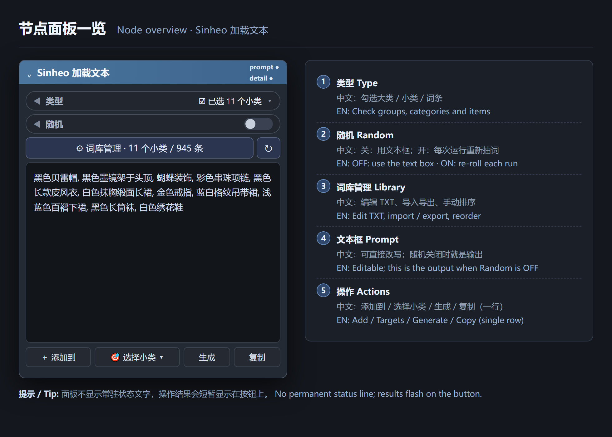
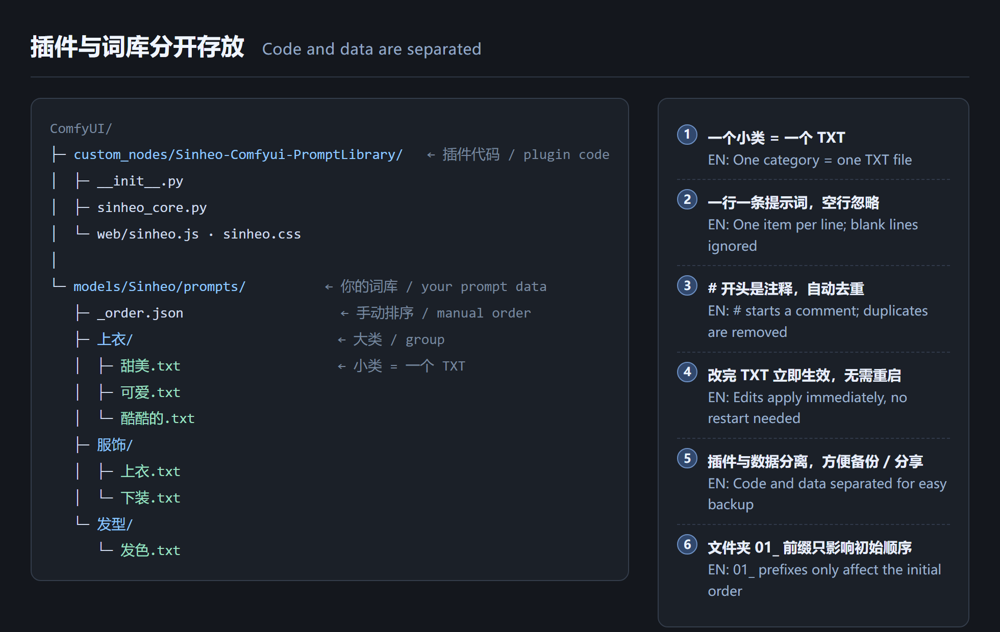
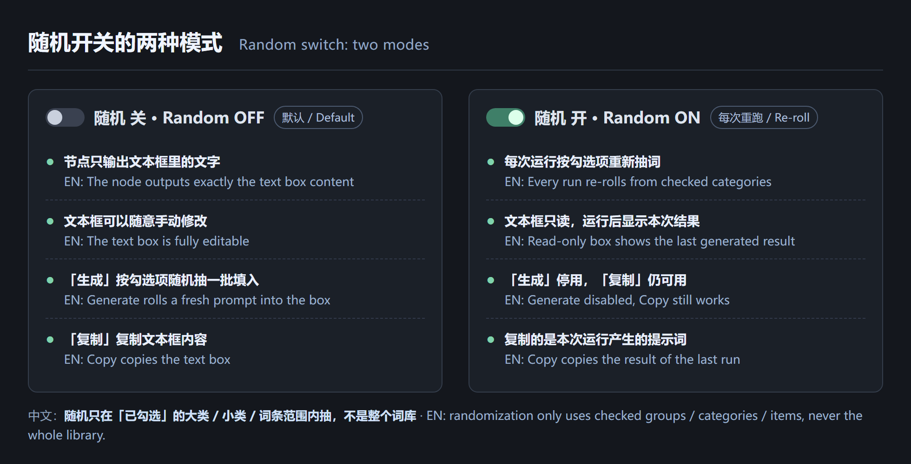
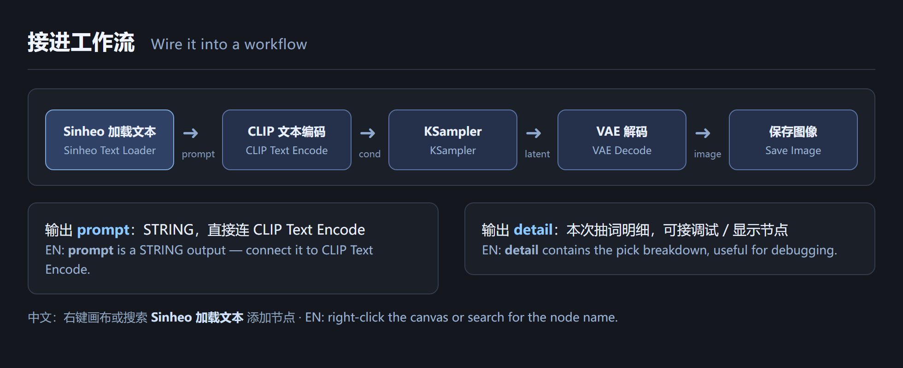
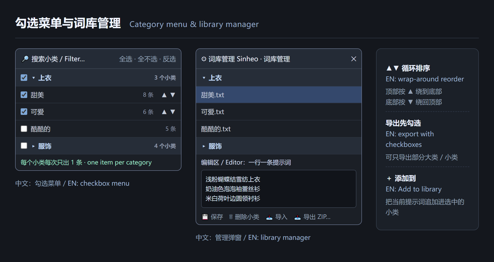

# Sinheo-Comfyui-PromptLibrary · Sinheo 加载文本 / Text Loader

> **仓库 & 插件目录 / Repo & plugin folder**：`Sinheo-Comfyui-PromptLibrary`（两者同名 / same name for both）
>
> **中文**：把「提示词管理.html」搬进 ComfyUI 的**文字版提示词库节点**，界面按 Goohai 图库节点的紧凑样式重做。勾选大类 / 小类、随机抽词、手动排序、词库管理、导入导出，全部在一个节点里完成。
> **English**: A **text-based prompt library node** for ComfyUI, styled after Goohai's compact image-library node. Pick groups / categories, roll random prompts, reorder them, manage the library, import & export — all from one node.



| 中文 | English |
| --- | --- |
| 本页是**中英对照**速览。 | This page is a **bilingual** quick reference. |
| **完整图文教程**（分 9 步、5 张插图）：[docs/TUTORIAL.md](docs/TUTORIAL.md) | **Full illustrated tutorial** (9 steps, 5 images): [docs/TUTORIAL.md](docs/TUTORIAL.md) |
| 中文完整参考手册：[docs/REFERENCE.zh-CN.md](docs/REFERENCE.zh-CN.md) | Full Chinese reference: [docs/REFERENCE.zh-CN.md](docs/REFERENCE.zh-CN.md) |
| 起步词库：[examples/prompts/](examples/prompts/) | Starter library: [examples/prompts/](examples/prompts/) |
| **当前版本 / Current version**：`2.0.0`，更新内容见 [CHANGELOG.md](CHANGELOG.md) | **Current version**: `2.0.0` — see [CHANGELOG.md](CHANGELOG.md) |

---

## 1. 简介 | About

| 中文 | English |
| --- | --- |
| **插件和数据彻底分开**：代码在 `custom_nodes/`，提示词全在 `models/`。直接用资源管理器改 TXT 就能加词，不用重启 ComfyUI，备份 / 分享词库也不会碰到代码。 | **Code and data are separated**: the plugin lives in `custom_nodes/`, all prompts live in `models/`. Edit the TXT files in Explorer / Finder to add prompts — no restart, and backing up your library never touches the code. |
| 词库只有**两级**：`大类/` 文件夹 + `小类.txt` 文件。一个小类就是一个 TXT，每次随机只从该小类里出 **1 条**；类型菜单也只显示「大类 / 小类」两级，不展开具体提示词。 | The library has **two levels**: a `Group/` folder plus `Category.txt` files. One category = one TXT, and each roll contributes **exactly one item** per category. The source menu also shows only these two levels — individual entries are never expanded. |
| 节点输出 `prompt`（STRING）与 `detail`（抽词明细），直接接 `CLIP Text Encode`。 | The node outputs `prompt` (STRING) and `detail` (pick breakdown); wire `prompt` straight into `CLIP Text Encode`. |

---

## 2. 安装 | Install

| 中文 | English |
| --- | --- |
| 把本仓库整个文件夹放进 `ComfyUI/custom_nodes/Sinheo-Comfyui-PromptLibrary/`，重启 ComfyUI，然后右键画布或搜索 **`Sinheo 加载文本`** 添加节点。 | Put this folder at `ComfyUI/custom_nodes/Sinheo-Comfyui-PromptLibrary/`, restart ComfyUI, then right-click the canvas or search for **`Sinheo 加载文本`** to add the node. |
| 仓库与插件目录**同名**，直接 `git clone <仓库地址> custom_nodes/Sinheo-Comfyui-PromptLibrary` 即可，解压 ZIP 也无需改名。 | The repo and the plugin folder share the **same name** — just run `git clone <repo-url> custom_nodes/Sinheo-Comfyui-PromptLibrary`; unzipping a ZIP needs no renaming either. |
| 想立刻有词可用：把 [examples/prompts/](examples/prompts/) 里的内容复制到 `ComfyUI/models/Sinheo/prompts/`。 | For an instant library, copy everything in [examples/prompts/](examples/prompts/) into `ComfyUI/models/Sinheo/prompts/`. |

```text
ComfyUI/
├── custom_nodes/
│   └── Sinheo-Comfyui-PromptLibrary/         ← 插件代码 / plugin code
│       ├── __init__.py          节点定义 + HTTP API / node + API
│       ├── sinheo_core.py       扫描、生成、编辑、导入导出 / core logic
│       └── web/sinheo.js|css    节点面板 / front-end panel
└── models/
    └── Sinheo/
        └── prompts/            ← 你的词库 / your prompt data
```



---

## 3. 词库规则 | Library rules

| 中文 | English |
| --- | --- |
| 一个小类 = 一个 TXT；一行一条提示词；空行忽略，`#` 开头是注释；同文件自动去重。 | One category = one TXT; one item per line; blank lines ignored; `#` starts a comment; duplicates are removed. |
| 文件夹名前的 `01_` `02_` 只影响**初始顺序**，界面会去掉前缀显示。真正的顺序靠菜单里的 ▲▼ 手动排，可「设为默认顺序」写进 `_order.json`。 | `01_` / `02_` prefixes only affect the **initial order** and are hidden in the UI. Real ordering is done with ▲▼ in the menu and can be saved to `_order.json`. |
| **循环排序**：顶部按 ▲ 绕到底部，底部按 ▼ 绕回顶部。 | **Wrap-around reorder**: ▲ on the first item sends it to the bottom; ▼ on the last sends it to the top. |
| 随机**只在已勾选**的大类 / 小类范围内抽，不是整个词库；勾选一个小类 = 这个小类整包参与。 | Randomization only uses **checked** groups / categories — never the whole library; checking a category includes all its entries. |
| 改完 TXT 立即生效；也支持在 `extra_model_paths.yaml` 里追加 `sinheo_prompts` 只读目录。 | Edits apply immediately; extra read-only roots can be added via `sinheo_prompts` in `extra_model_paths.yaml`. |

---

## 4. 面板与按钮 | Panel & buttons


| 区域 | 中文 | English |
| --- | --- | --- |
| `◀ 类型 ▾` | 打开**类型菜单**：顶部可在「词库 / 图库」之间切换随机数据源；词库模式下小类整组右移、与大类分层，可勾选大类 / 小类（点小类名称也能勾选）、搜索、排序。 | Opens the **source menu**: switch the random source between Library / Gallery; categories are indented under their group, check groups / categories (clicking a category name toggles it too), search and reorder. |
| `◀ 随机` | 总开关：关 = 输出文本框内容；开 = 每次运行按当前数据源（词库词条或图库卡片）重新抽词。 | Master switch: OFF = output the text box; ON = re-roll on every run from the chosen source (library entries or gallery cards). |
| `⚙ 词库管理` / `🖼 图库管理` | 两个按钮**等宽**，打开的两个弹窗也**同宽**（共用 `--sh-panel-width`）。词库管理可编辑 TXT、新建 / 删除、导入导出；`↻` 重新扫描。按钮与面板都不再显示「几个小类 / 几条 / 几张」这类数量统计。 | The two buttons are **equal-width** and both dialogs share the **same width** (`--sh-panel-width`). The manager edits TXT, creates / deletes, imports / exports; `↻` rescans. No item / card counters are shown anywhere on the panel. |
| 左侧 `外部文本` 输入点 | 可接任意文本节点的 `STRING` 输出；连线后本节点**直接输出上游文本**，优先级高于随机开关、类型菜单与自带文本框。 | An optional `STRING` input; when linked, the node simply passes through the upstream text, overriding Random / source menu / its own text box. |
| 大文本框 | 可直接编辑的提示词。随机关闭时它就是最终输出；接了外部文本或开了随机后变为只读展示区。 | Editable prompt text; final output when Random is OFF; becomes a read-only preview with an external link or Random ON. |
| `＋ 添加到图库` | 把当前提示词 + **最近生成的图片**存成图库卡片；设过目标分类后可一键静默保存。点「↻ 抓取最近生成图」优先读服务端 `/history` 的真实执行输出（只可能是 SaveImage / PreviewImage），再读当前会话输出，最后才是插件后端只扫 `output` 目录的磁盘兜底。`type=input` 的加载图和 LoadImage 节点预览一律排除，**不会再把「加载图像」的输入原图抓进来**。 | Saves the current prompt + **the latest generated image** as a gallery card; one-click save once a target is remembered. **Grab latest image** prefers the server `/history` outputs (only SaveImage / PreviewImage), then the current session outputs, then a disk fallback that scans `output` only. `type=input` loads and LoadImage node previews are always excluded — **the input photo is never grabbed by mistake**. |
| `🎯 目标分类 ▾` | 打开添加弹窗：选分类 / 分组、预览图片、修改提示词，或切换「只记住目标」开关。 | Opens the add dialog: pick category / group, preview the image, edit the prompt, or toggle the remembered target. |
| `✓ 只记住目标` | 添加弹窗底部的开关：点一次把当前分类 / 分组写进 `localStorage`，**刷新页面后仍生效**（节点按钮变成「🎯 目标已设 ▾」、点「＋ 添加到图库」一键静默保存）；**再点一次即取消**，之后点「＋ 添加到图库」会重新弹窗。点「保存到图库」不会隐式记住目标。 | Toggle in the add dialog: persists the target across reloads (one-click silent save); click again to cancel. Saving a card does not implicitly remember a target. |
| `生成` | 手动随机抽一批填进文本框（仅随机关闭时可用）。 | Manually rolls a fresh prompt into the box (only when Random is OFF). |
| `复制` | 复制文本框内容；随机模式下复制**本次运行产生的**提示词。 | Copies the text box; with Random ON it copies **the result of the last run**. |

> 底部四个按钮固定**一行**，面板不显示常驻状态文字，也不显示数量统计，操作结果会短暂显示在按钮上。
> The four buttons stay on a **single row**; no permanent status line and no counters — results flash on the button.

### 接入外部文本 | External text input

节点左侧有一个可选的 `外部文本`（`external_text`）`STRING` 输入点，可以接 `字符串（多行）`、其它提示词节点或任意输出 `STRING` 的节点。

- **连线后**：节点直接透传上游文本，忽略随机开关、词库 / 图库数据源、拼接设置与自带文本框；`prompt` 输出的就是上游内容，`detail` 会注明来源。
- **文本框**：变为只读展示区，运行一次工作流后显示本次实际传入的提示词，但不会写回隐藏的 `manual_text` widget，所以断开连线后原先手写的文字仍在。
- **其它按钮**：`生成` 停用；`复制`、`＋ 添加到图库` 仍可用，作用对象就是当前展示的文本。
- 缓存指纹会把外部文本纳入计算，上游内容变了就会重新执行；老工作流载入时前端会自动补齐这个新输入点。

### 图库管理 | Gallery

节点上的 `🖼 图库管理` 打开独立弹窗（与词库管理弹窗同宽）：分类标签 / 收藏栏、左侧分组、按提示词搜索；右上角按钮组依次为「✎ 编辑 / ⬆ 导入 / ⬇ 导出 / ✕ 关闭」，编辑紧挨导入左边。用 ZIP（`library.json` + `images/`）备份或迁移，覆盖导入前自动整库备份。卡片只有图片 + 提示词，没有标题字段。

**图片只存缩略图**：这个插件的核心是提示词，图片只是让人一眼认出「这条提示词大概出什么效果」。所以上传前浏览器先用 canvas 压成**最长边 512px 的 JPEG（q82，透明区铺白底）**，服务端 `save_image()` / `import_archive()` 再用 Pillow 兜一层，`export_zip()` 打包时还要检查一遍——存进去的、导入的、导出的都是缩略图，一张通常 30~80 KB，而不是 2~8 MB 的原图 PNG。已是达标小 JPEG 不会重复编码，反复导入导出不会越压越糊；环境缺 Pillow 时前端缩略图仍生效。Gallery images are always 512px JPEG thumbnails — stored, imported and exported — because the prompt is the point, not the pixels.

**历史原图不自动迁移**：升级前存进 `images/` 的原图仍在磁盘上（导出的包不会带上，包内一律是缩略图）；要腾空间直接删掉这些旧文件即可，重新添加卡片后就是缩略图。插件不再提供「一键压缩」——它按目录统计、会把没有卡片引用的孤儿图也算进去，容易和界面上的卡片数对不上。

**卡片布局**：默认「▦ 整齐」——每个格子固定高度，不同宽高比的图片都 `object-fit: contain` **完整显示**并居中，四周用深色补齐，不再高低错落、行内也不再出现大片空白；搜索行右侧可一键切成「▤ 原比例」瀑布流（按真实比例紧密排列），选择会记住。图片文件丢失时显示占位，不会出现空白卡。按钮条 `使用 / 复制 / ♥ 收藏` 直接浮在图片底部，允许遮挡画面；提示词作为悬停浮层显示，鼠标移开不挡图。Cards default to a fixed-height grid with `object-fit: contain` (no cropping, no ragged rows); toggle to a masonry flow from the search bar. Missing images show a placeholder.

**「无法从网站上提取文件」的真正原因（更正）**：之前把它归因为「图库 ZIP 有 10 MB、太大」是不准确的——实测小包同样失败。服务端一直正常（`/api/sinheo/gallery/download` 返回 200、`Content-Length` 10,745,940、`export_blob` 0.34 秒生成），问题出在**由网页发起的下载本身**：`blob:` URL、`<a download>`、attachment 直链在这个 Edge / 启动器内嵌窗口环境里会被下载管理器一律拦下，与文件大小无关；10 MB 只是让旧链路（重复打包三次、堆满 `output/Sinheo/exports/`）更容易失败。系统「另存为」(`showSaveFilePicker`) 同样要浏览器授权，所以点了也没反应。It's the browser download sandbox, not the file size.

**导出（自己选位置）**：点「⬇ 导出」只打开导出面板，**不会自动打包或下载**。面板只有「取消 / 💾 保存到该位置」两个按钮；「保存到」填本机目录（或完整 `.zip` 路径），由 `POST /sinheo/gallery/export_to` 让 ComfyUI 服务端直接写盘，全程不产生 `blob:` URL、不经过下载管理器。**上次用的目录会被记住并写入 `localStorage`，下次打开面板、甚至刷新页面后都会自动填回**（记住的是文件夹本身，不会像旧版那样变成某个 ZIP 文件名）。首次使用才向 `GET /sinheo/gallery/export_dir` 取 ComfyUI 默认目录。成功后显示实际保存路径，点一下即可复制；同名文件会覆盖。包里的 `images/` 全是缩略图（即使本机磁盘上还留着升级前的原图，导出时也会在内存里换掉，包本身自洽、可直接导入）。面板只保留文件名 / 保存目录 / 范围三行输入和两个右下角按钮，不再显示大段说明文字。The chosen folder is remembered across reloads; exported archives contain thumbnails only.

**导出范围**：面板里「分类 / 分组」两个下拉默认「整个图库 / 全部分组」；选分类只导出该分类的全部卡片，选分组只导出该分类下这一组的卡片。`library.json` 与 `images/` 会一起裁剪，所以子集包仍可直接用「⬆ 导入」合并或覆盖还原，不会出现孤立引用；范围通过 `POST /export_to` 的 `category` / `group` 字段提交。Export scope can be limited to one category or one group; the subset archive stays importable.

**文件名规则**：`Sinheo_gallery_年-月-日-时-分-秒-毫秒.zip`，用**本机本地时间**（旧版误用 UTC，比北京时间慢 8 小时）；每次点导出按钮都会刷新成新名字，不再反复覆盖同一个文件；手动改过文件名后会一直保留你填的名字。同一毫秒内连续导出会自动追加序号。Filenames use local time + milliseconds and refresh on every export; a manually edited name is kept.

**为什么「另存为…」和「交给浏览器下载」被移除了**：「另存为」调用浏览器的 `showSaveFilePicker`（需顶层窗口 + `https` / `127.0.0.1` 安全上下文），而且浏览器**不会把系统对话框里选中的真实路径交给网页**——它在绘世启动器内嵌窗口里既弹不出来，也无法把结果告诉服务端写盘。「交给浏览器下载」走的正是上面被下载管理器拦截的 `<a download>` / `blob:` 通道。这两条在当前环境都不可能可靠工作，留着只会误导，已从图库导出面板移除；后端 `export_blob / export_info / download` 路由仅作兼容保留，词库导出仍沿用原通道（体量小、行为不变）。Both browser-side channels were removed from the gallery export panel; only server-side writing remains.

> 本轮改了 Python 后端（所有图片写入口改走缩略图，并移除了 `/sinheo/gallery/optimize` 路由），**请重启 ComfyUI 后 `Ctrl+F5` 硬刷新**。重启后新存的图片由浏览器 + 服务端双重缩略，磁盘上就是 512px JPEG。

数据目录：`ComfyUI/models/Sinheo/gallery/`。元数据存储用 JSON（轻量、可读、原子写、每次保存前自动快照到 `.backup/`），512px JPEG 缩略图独立放 `images/`；对外分享用 ZIP 一次带走两者。数据层集中在 `sinheo_gallery.py`，以后换成 SQLite 只需改这一个文件。

---

## 5. 两种模式 | Two modes



| 中文 | English |
| --- | --- |
| **随机 关（默认）**：节点只输出文本框里的文字，可随意手改；「生成」按勾选项抽一批填入；「复制」复制文本框。 | **Random OFF (default)**: outputs exactly the text box; edit freely; `Generate` rolls a fresh prompt; `Copy` copies the box. |
| **随机 开**：每次运行重新抽词，文本框只读并在运行后显示本次结果；「生成」停用，但「复制」与「＋ 添加到」仍可用。 | **Random ON**: re-rolls every run; the box is read-only and shows the last result; `Generate` is disabled while `Copy` and `Add to` still work. |
| 缓存指纹在随机开时返回 `NaN`，保证每次排队运行都会重新抽词。 | With Random ON the fingerprint returns `NaN`, so every queued run really re-rolls. |

---

## 6. 接入工作流 | Wire it into a workflow



| 中文 | English |
| --- | --- |
| `prompt` → `CLIP Text Encode` → `KSampler` → `VAE Decode` → `Save Image`。 | `prompt` → `CLIP Text Encode` → `KSampler` → `VAE Decode` → `Save Image`. |
| `detail` 是本次抽词明细，适合接调试 / 显示节点。 | `detail` holds the pick breakdown — handy for debugging. |

---

## 7. 词库管理、导入导出 | Manager, import & export



| 中文 | English |
| --- | --- |
| 导入可选「导入到大类」，支持 TXT / ZIP 拖入或直接选文件。 | Import lets you choose a target group from a dropdown; TXT / ZIP supported. |
| 点「导出 ZIP」会先弹出**勾选界面**，只导出勾中的大类 / 小类。 | `Export ZIP` opens a **checkbox dialog** first, so only checked groups / categories are exported. |
| 删除会把原文件备份到 `.backup/`；旧三级目录（大类/小类/多个 TXT）首次扫描时自动展平并整份备份。 | Deletions are backed up to `.backup/`; legacy three-level folders are auto-flattened and fully backed up on first scan. |
| 管理弹窗里可设置分隔符 / 前缀 / 后缀 / 一次生成条数。 | The manager also configures separator, prefix, suffix and batch size. |

---

## 8. HTTP API & 测试 | HTTP API & tests

| 中文 | English |
| --- | --- |
| 插件注册 25 个路由：`/sinheo/library`、`generate`、`save`、`create`、`append`、`delete`、`delete_batch`、`rename`、`order`、`migrate`、`import`、`export`，以及 `/sinheo/gallery`、`gallery/save`、`gallery/image`、`gallery/export`、`gallery/export_to`、`gallery/export_dir`、`gallery/export_info`、`gallery/download`、`gallery/import` 等，全部由前端面板调用。 | The plugin registers 25 routes covering library CRUD, rename / batch delete, import / export, and gallery metadata / thumbnail upload / archive endpoints. |
| 见 [docs/REFERENCE.zh-CN.md](docs/REFERENCE.zh-CN.md) 的完整 API 表。 | See [docs/REFERENCE.zh-CN.md](docs/REFERENCE.zh-CN.md) for the full API table. |

```bash
python -m unittest discover -s tests -p "test_*.py"          # 53 tests / 53 项单测
node tests/smoke_frontend.mjs                                # front-end smoke test / 前端冒烟
python tests/test_comfyui_stub.py                           # route self-check / 路由自检（临时词库）

真实 Pillow 缩略图用例需要 ComfyUI 自带 Python（已带 Pillow 12.x）；用系统 Python 跑时会自动跳过这 6 项，其余全部通过。
```

---

## 9. 文档与许可 | Docs & license

| 中文 | English |
| --- | --- |
| 📖 [图文教程（中英对照）](docs/TUTORIAL.md) · 📄 [中文参考手册](docs/REFERENCE.zh-CN.md) · 📁 [示例词库](examples/prompts/) | 📖 [Illustrated tutorial (bilingual)](docs/TUTORIAL.md) · 📄 [Chinese reference](docs/REFERENCE.zh-CN.md) · 📁 [Starter library](examples/prompts/) |
| 基于 ComfyUI（0.44+）与 V3 IO API；前端使用原生 JS / CSS，无第三方依赖。 | Built for ComfyUI 0.44+ with the V3 IO API; vanilla JS / CSS, no third-party dependencies. |
| MIT License，见 [LICENSE](LICENSE)。 | MIT License — see [LICENSE](LICENSE). |
