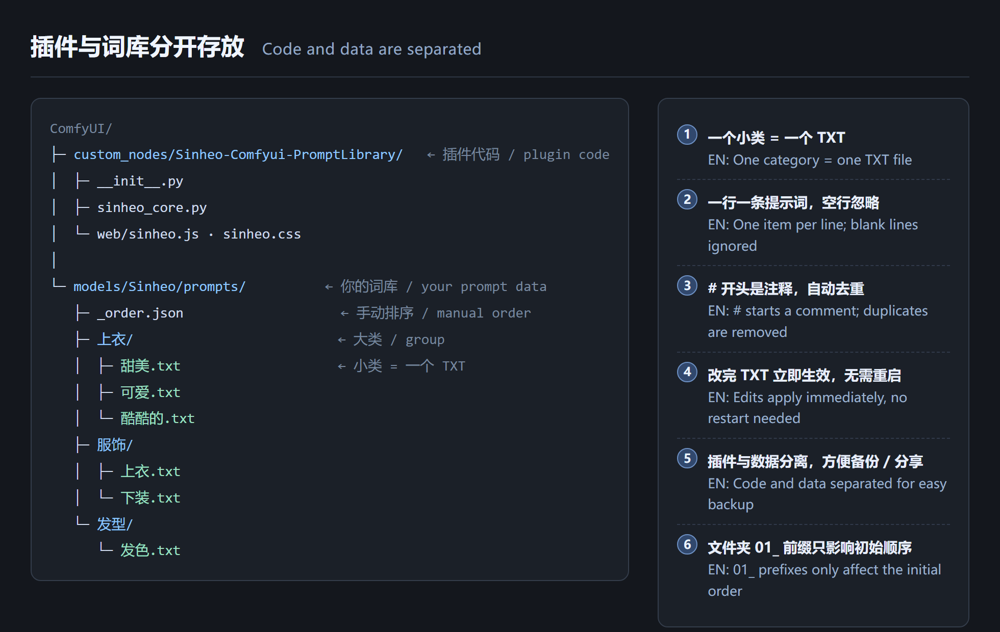
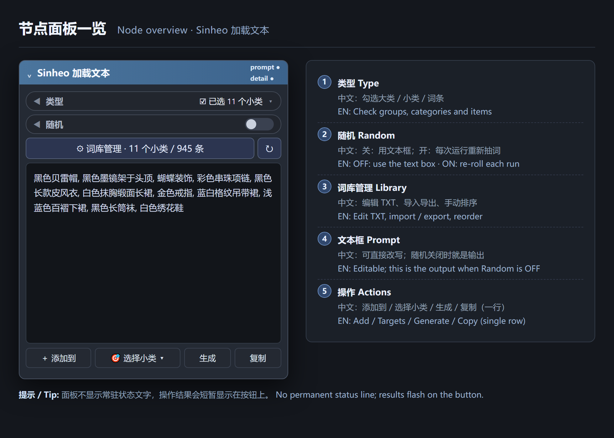
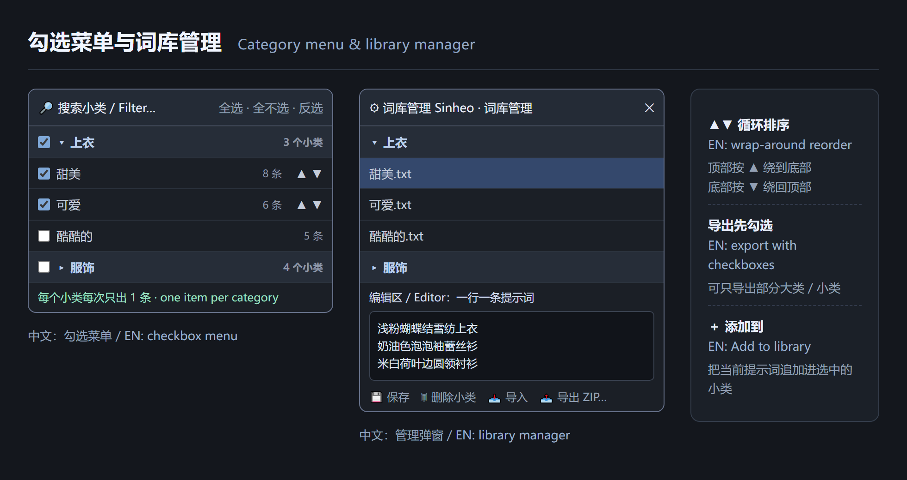
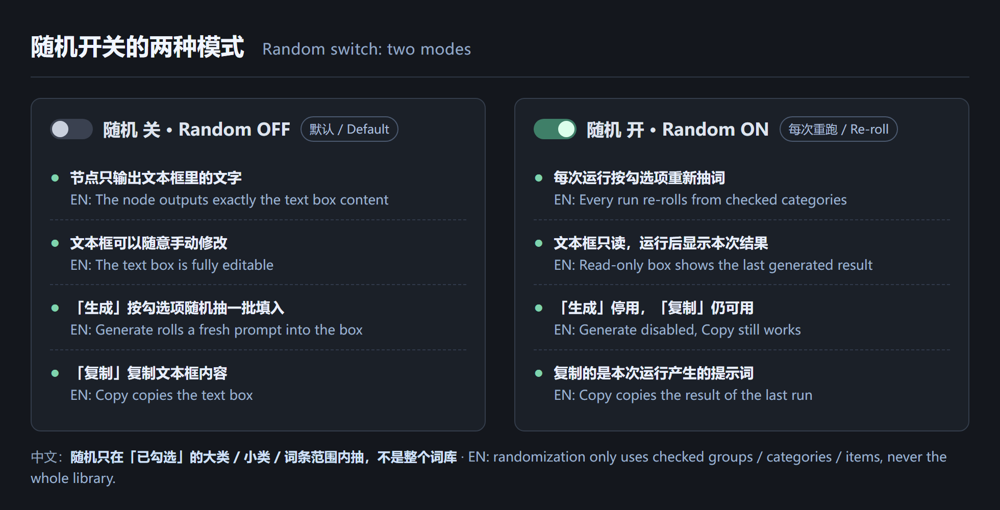
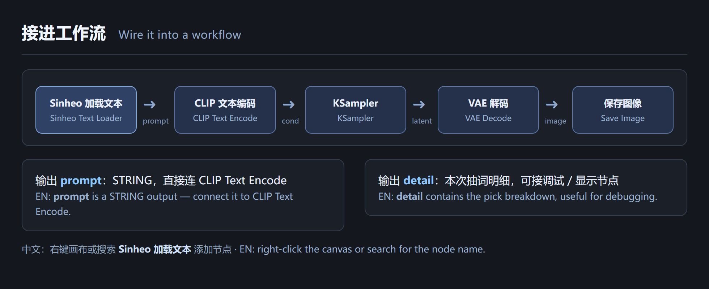

# 图文教程 · Illustrated Tutorial

**Sinheo-Comfyui-PromptLibrary · Sinheo 加载文本**

| 中文 | English |
| --- | --- |
| 本教程每一步都是**中英对照**：左边中文，右边 English。插图用插件真实界面渲染，不是手绘示意图。 | Every step is **bilingual**: Chinese on the left, English on the right. The images are rendered from the plugin's real CSS, not hand-drawn mockups. |
| 从零开始：装插件 → 建词库 → 勾选 → 生成 → 接工作流 → 备份。 | From zero to done: install → build the library → check items → generate → wire the workflow → back up. |
| 先回到 [README](../README.md) 看速览，或查 [中文参考手册](REFERENCE.zh-CN.md) 看 API 全表。 | See the [README](../README.md) for a quick reference, or the [Chinese manual](REFERENCE.zh-CN.md) for the full API table. |

**目录 / Contents**

1. [安装插件 / Install](#1-安装插件--install)
2. [认识节点面板 / Node overview](#2-认识节点面板--node-overview)
3. [建立自己的词库 / Build your library](#3-建立自己的词库--build-your-library)
4. [勾选与排序 / Check & reorder](#4-勾选与排序--check--reorder)
5. [生成、手改、复制 / Generate, edit, copy](#5-生成手改复制--generate-edit-copy)
6. [把好词收藏回词库 / Add prompts back](#6-把好词收藏回词库--add-prompts-back)
7. [随机开关两种模式 / Two random modes](#7-随机开关两种模式--two-random-modes)
8. [接入工作流 / Wire the workflow](#8-接入工作流--wire-the-workflow)
9. [备份与导入导出 / Backup, import & export](#9-备份与导入导出--backup-import--export)
10. [常见问题 / FAQ](#10-常见问题--faq)

---

## 1. 安装插件 / Install



| 中文 | English |
| --- | --- |
| ① 把仓库克隆 / 解压到 `ComfyUI/custom_nodes/Sinheo-Comfyui-PromptLibrary/`（仓库与插件目录同名，无需改名）。 | ① Clone / unzip the repo into `ComfyUI/custom_nodes/Sinheo-Comfyui-PromptLibrary/` (repo and plugin folder share the same name — no renaming). |
| ② 把 `examples/prompts/` 里的内容复制到 `ComfyUI/models/Sinheo/prompts/`（目录不存在就新建）。也可以先留空，之后在管理界面里建。 | ② Copy `examples/prompts/` into `ComfyUI/models/Sinheo/prompts/` (create it if missing). An empty folder is fine too — you can build it inside the manager later. |
| ③ **重启 ComfyUI**，否则新的 Python 路由不会注册。 | ③ **Restart ComfyUI** so the Python routes get registered. |
| ④ 右键画布 → 添加节点 → 搜索 **`Sinheo 加载文本`**（分类 `Sinheo / 文本`）。 | ④ Right-click the canvas → Add Node → search **`Sinheo 加载文本`** (category `Sinheo / 文本`). |

> 💡 中文：代码在 `custom_nodes/`，数据永远在 `models/`，两者互不干扰。　**EN**: Code stays in `custom_nodes/`, data stays in `models/` — they never mix.

---

## 2. 认识节点面板 / Node overview



| 中文 | English |
| --- | --- |
| ① **类型**：点这一行打开勾选菜单，行尾显示已选小类数。 | ① **Type**: click the row to open the checkbox menu; the right side shows how many categories are checked. |
| ② **随机**：开关。关 = 用文本框；开 = 每次运行重新抽词。 | ② **Random**: OFF = use the text box; ON = re-roll on every run. |
| ③ **词库管理**：编辑 TXT、导入导出、手动排序；右边 `↻` 重新扫描词库。 | ③ **Library manager**: edit TXT, import / export, reorder; `↻` rescans the library. |
| ④ **文本框**：可直接改写的提示词，随机关闭时它就是节点的输出。 | ④ **Text box**: editable prompt; with Random OFF this is exactly what the node outputs. |
| ⑤ **一行四个按钮**：`＋ 添加到` → `🎯 选择小类 ▾` → `生成` → `复制`。 | ⑤ **One row of four buttons**: `＋ Add to` → `🎯 Targets ▾` → `Generate` → `Copy`. |

> 💡 中文：面板没有常驻状态文字；「已生成 / 已复制 / 已添加」会短暂显示在按钮上，详细信息悬停按钮可见。　**EN**: No permanent status line; results flash on the button and details are available on hover.

---

## 3. 建立自己的词库 / Build your library

```text
models/Sinheo/prompts/          ← 你的词库根目录 / library root
├── 上衣/                        ← 大类：文件夹 / group = folder
│   ├── 甜美.txt                 ← 小类：一个 TXT / category = one TXT
│   ├── 可爱.txt
│   └── 酷酷的.txt
├── 发型/
│   └── 发色.txt
└── _order.json                 ← 手动排序结果，插件自动维护 / auto-maintained
```

| 中文 | English |
| --- | --- |
| 大类 = 文件夹，小类 = 一个 `.txt` 文件；**不要**再往小类里套文件夹。 | Group = folder, category = one `.txt` file; **no** deeper nesting. |
| 一行一条提示词；空行忽略；`#` 开头是注释；同文件内自动去重。 | One item per line; blank lines ignored; `#` starts a comment; duplicates removed. |
| 例：`上衣/甜美.txt` 里写「浅粉蝴蝶结雪纺上衣」「奶油色泡泡袖蕾丝衫」…… | Example: put `a pink bow chiffon top`, `cream puff-sleeve lace blouse`, … in `Tops/Sweet.txt`. |
| 用资源管理器改完 TXT **立即生效**，不用重启；点 `↻` 可立刻刷新计数。 | Edits in Explorer / Finder apply **immediately** — no restart; hit `↻` to refresh the counters. |
| 也可以在「词库管理」弹窗里新建大类 / 小类，直接在编辑区粘贴多行词条再保存。 | You can also create groups / categories in the manager and paste multiple lines into the editor. |
| 文件夹名加 `01_` `02_` 只影响初始顺序，界面会自动去掉前缀显示。 | `01_` / `02_` prefixes only affect the initial order and are hidden in the UI. |

> 💡 中文：想加只读词库，可在 `extra_model_paths.yaml` 里追加 `sinheo_prompts` 目录。　**EN**: Add extra read-only roots via `sinheo_prompts` in `extra_model_paths.yaml`.

---

## 4. 勾选与排序 / Check & reorder



| 中文 | English |
| --- | --- |
| 点「类型」打开勾选菜单：勾大类 = 勾它下面全部小类，也能单独展开勾**具体词条**。 | Click **Type** to open the checkbox menu: checking a group checks all its categories; expand one to pick **individual items**. |
| 顶部有搜索框和「全选 / 全不选 / 反选」，词多的时候很好用。 | A filter box plus Select all / none / invert sits at the top — handy for large libraries. |
| **每个小类每次只出 1 条**，不会把整个小类拼成一长串。 | **Each category contributes exactly one item** per roll — never the whole list concatenated. |
| ▲▼ 手动排序是**循环**的：顶部按 ▲ 绕到底部，底部按 ▼ 绕回顶部。排完可「设为默认顺序」写进 `_order.json`，新节点会继承。 | ▲▼ reordering **wraps around**: ▲ on the first item sends it to the bottom, ▼ on the last sends it to the top. Save as default to `_order.json` so new nodes inherit it. |
| 随机**只在已勾选的范围里抽**，没勾的大类 / 小类 / 词条完全不参与。 | Randomization only uses **checked** items; unchecked groups / categories / items never participate. |

---

## 5. 生成、手改、复制 / Generate, edit, copy

| 中文 | English |
| --- | --- |
| 保持「随机」**关闭**，点 `生成`：按当前勾选菜单抽一批词填进文本框，顺序就是菜单里的顺序。 | Keep Random **OFF** and press `Generate`: a fresh prompt is rolled from the checked items, in menu order. |
| 生成的文字可以**直接手动改**，改什么就输出什么，前缀 / 后缀 / 词库都不再参与运算。 | The result is **fully editable** — what you type is what gets output; prefixes / suffixes / library no longer take part. |
| 点 `复制` 把文本框内容放进剪贴板，方便贴到别处。 | `Copy` puts the text box into the clipboard. |
| 新节点会自动按菜单顺序填一份初始提示词，不会一上来就是空白。 | New nodes are pre-filled in menu order, so they never start empty. |

> 💡 中文：改了勾选菜单后，文本框不会自动变 —— 点一下 `生成` 才会更新。　**EN**: Changing the menu does not auto-update the text box; press `Generate` to refresh it.

---

## 6. 把好词收藏回词库 / Add prompts back

| 中文 | English |
| --- | --- |
| 点 `🎯 选择小类 ▾`，在弹窗里勾选要把提示词存进哪些小类（可多选、可搜索、可整组勾）。 | Press `🎯 Targets ▾` and check the categories that should receive the prompt (multi-select, searchable, group-selectable). |
| `✓ 确定选择` 只记住目标；`＋ 添加到选中（N）` 会记住并**立刻写入**。 | `✓ Confirm` only remembers targets; `＋ Add to selected (N)` remembers **and writes immediately**. |
| 之后直接点节点上的 `＋ 添加到` 就能重复添加到同一批目标，按钮旁会显示「已选 N 类」。 | Later, a single click on `＋ Add to` reuses those targets; the button shows how many are selected. |
| 写入是**只追加**：保留原 TXT 的注释、顺序、行尾格式，已存在的词自动跳过。一行算一条；多行文本会一次加多条。 | Writes are **append-only**: comments, order and line endings are preserved, duplicates skipped. One line = one item; multi-line text adds several. |
| 随机模式下也能用，此时收藏的是**本次运行刚抽出来的**提示词。 | Works with Random ON too — it saves **the prompt produced by the last run**. |

---

## 7. 随机开关两种模式 / Two random modes



| 中文（随机 关） | English (Random OFF) |
| --- | --- |
| 节点输出文本框里的文字，可手改；`生成` 可用；`复制` 复制文本框。 | Outputs the text box, editable; `Generate` enabled; `Copy` copies the box. |

| 中文（随机 开） | English (Random ON) |
| --- | --- |
| 每次排队运行都按勾选项**重新抽词**，文本框只读并在运行后显示本次结果；`生成` 停用，`复制` 仍可用且复制的是**本次运行结果**；关掉随机后你原来写的文字原样恢复。 | Every queued run **re-rolls** from checked items; the box is read-only and shows the last result; `Generate` disabled; `Copy` still works and copies **that last result**; switching OFF restores your original text. |

> 💡 中文：随机开时节点指纹返回 `NaN`，ComfyUI 不会缓存，所以每次运行真的会换一批词。　**EN**: With Random ON the fingerprint is `NaN`, so ComfyUI never caches and each run really re-rolls.

---

## 8. 接入工作流 / Wire the workflow



| 中文 | English |
| --- | --- |
| `Sinheo 加载文本` 的 `prompt`（STRING）→ `CLIP Text Encode` → `KSampler` → `VAE Decode` → `Save Image`。 | Connect `prompt` (STRING) → `CLIP Text Encode` → `KSampler` → `VAE Decode` → `Save Image`. |
| `detail` 是本次抽词明细，可接调试 / 显示节点，看看每个小类到底抽了哪一条。 | `detail` contains the pick breakdown — wire it to a display / debug node to see what each category produced. |
| 想固定某一批词：随机开运行一次 → 看文本框结果 → 关掉随机（会保留原文）→ 手动微调 → 再运行。 | To freeze a good roll: run with Random ON → read the result → switch Random OFF (text is kept) → tweak → run again. |

---

## 9. 备份与导入导出 / Backup, import & export


| 中文 | English |
| --- | --- |
| 词库就是一个普通文件夹，直接复制 `models/Sinheo/prompts/` 就是完整备份。 | The library is a plain folder — copying `models/Sinheo/prompts/` is a full backup. |
| 点「导出 ZIP」先弹出**勾选界面**，只导出勾中的大类 / 小类；导入时可选「导入到大类」，支持 TXT / ZIP。 | `Export ZIP` opens a **checkbox dialog** so only checked groups / categories are exported; import offers a target-group dropdown and accepts TXT / ZIP. |
| 删除小类会把原文件移到 `models/Sinheo/prompts/.backup/<时间戳>/`，误删可以找回。 | Deleting a category moves the original into `models/Sinheo/prompts/.backup/<timestamp>/` for recovery. |
| 旧版三级目录（`上衣/甜美/多个 TXT`）首次扫描会**自动展平**成一个小类 TXT，词条一条不丢，并整份备份。 | Legacy three-level folders are **auto-flattened** into one category TXT on first scan — nothing is lost, and everything is backed up first. |

---

## 10. 常见问题 / FAQ

| 中文 | English |
| --- | --- |
| **面板没变化 / 接口 404、405**：改完插件后必须**重启 ComfyUI**（Python 进程）；静态 JS / CSS 用 Ctrl+F5 强刷即可。 | **Panel unchanged / 404, 405**: restart ComfyUI after changing the plugin; static JS / CSS only needs a hard refresh (Ctrl+F5). |
| **词库计数是 0**：确认路径是 `models/Sinheo/prompts/`，点 `↻` 重新扫描；也可以检查 `extra_model_paths.yaml` 里的 `sinheo_prompts`。 | **Library shows 0 items**: check the path `models/Sinheo/prompts/`, hit `↻`, and verify `sinheo_prompts` in `extra_model_paths.yaml`. |
| **顺序不对**：菜单里的 ▲▼ 才是真正的顺序；`01_` 前缀只影响初始顺序，「设为默认顺序」会写进 `_order.json`。 | **Wrong order**: ▲▼ in the menu is the real order; `01_` prefixes only set the initial order; "Save as default" writes `_order.json`. |
| **随机没变化**：确认随机开关是开的，并且至少勾了一个小类；随机关闭时节点只会输出文本框。 | **Random never changes**: make sure the switch is ON and at least one category is checked; with it OFF the node only outputs the text box. |
| **导出 0KB**：请用面板里的「导出 ZIP」按钮（会先弹勾选框），不要直接请求 `/sinheo/export`；勾选后下载才带 selection。 | **0 KB export**: use the `Export ZIP` button (it opens the checkbox dialog first); a bare `/sinheo/export` request has no selection. |
| **「复制」提示无内容**（随机模式）：先运行一次工作流，文本框才会显示本次生成的提示词。 | **`Copy` says empty** (Random ON): run the workflow once first so the box shows the generated prompt. |

---

| 中文 | English |
| --- | --- |
| 教程结束。更多细节见 [中文参考手册](REFERENCE.zh-CN.md) 与 [README](../README.md)。 | That's it. See the [Chinese manual](REFERENCE.zh-CN.md) and [README](../README.md) for details. |
